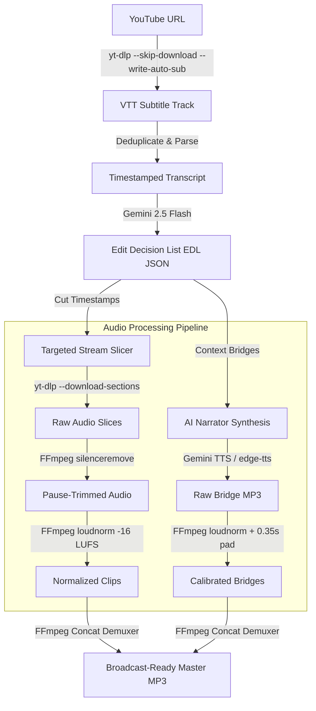

# Shortcast 🎙️✂️

> **Turn 4-hour YouTube podcasts into concise, broadcast-grade MP3s without losing real voices.**

[](https://python.org)
[](https://ffmpeg.org)
[](https://github.com/yt-dlp/yt-dlp)
[](https://deepmind.google/technologies/gemini/)
[](https://github.com/rany2/edge-tts)

---

## The Problem

Long-form podcasts (2 to 5 hours) are packed with deep, high-signal masterclasses, but also loaded with:
* 30-minute opening banter and sponsor plugs.
* Tangential rabbit holes and circular repetition.
* Dead-air pauses, hesitations, and silence gaps.

**Existing solutions fall short:**
* **Text / Executive Summaries**: Strip all nuance, emotional tone, and speaker personality.
* **NotebookLM / Synthetic AI Hosts**: Replace authentic guest voices with robotic AI voices.
* **Voice Cloning**: Unnatural cadence, licensing issues, and degraded audio fidelity.

---

## The Shortcast Solution: Hybrid Documentary Cut

Shortcast treats multi-hour studio podcasts like documentary footage:

1. **Keep 100% Authentic Voices**: Only the original speakers' voices are preserved.
2. **Selective Stream Slicing**: Uses `yt-dlp --download-sections` to pull only selected minutes directly from YouTube media servers—no downloading 4-hour video files.
3. **AI Narrator Bridges**: Generates short (8–10s) transition context bridges between non-contiguous cuts so 30-minute skips sound deliberate, cohesive, and seamless.
4. **Dead-Air & Silence Removal**: Strips internal conversational pauses (>0.45s at -35dB) without altering speaker pitch or cadence.
5. **Loudness Normalization**: Calibrates both guest studio audio and narration voiceovers to broadcast standard -16 LUFS.

---

## Architecture



---

## Benchmark Case Study

Tested on Nikhil Kamath's **WTF is Payments?** episode with PhonePe, Razorpay & NPCI:

| Metric | Original YouTube Video | Shortcast TIGHT Cut | Shortcast FULL Cut |
| :--- | :--- | :--- | :--- |
| **Duration** | **04:00:06** | **00:50:11** (~50m) | **01:09:41** (~70m) |
| **Time Saved** | 0% | **~79.1%** | **~70.9%** |
| **Segments** | Full Unedited Run | 6 Core Chapters | 11 Complete Chapters |
| **AI Bridges** | None | 6 Voiceover Bridges | 11 Voiceover Bridges |
| **Output Size** | ~4 GB (Video) | **68.9 MB** (192 kbps MP3) | **~96 MB** (192 kbps MP3) |

---

## Installation & Prerequisites

### 1. Prerequisites
* **Python**: 3.10 or higher
* **FFmpeg**: Modern build on system PATH (e.g. Gyan.FFmpeg or official builds)
* **yt-dlp**: Required for audio section downloading

On Windows:
```powershell
# Install FFmpeg via winget
winget install Gyan.FFmpeg

# Install Python packages
pip install yt-dlp google-genai edge-tts
```

---

## Usage

### Mode 1: Fully Automated from YouTube URL
Analyzes the subtitle track using Gemini 2.5 Flash, creates the EDL JSON, and renders the MP3:

```powershell
# Set your Gemini API key
$env:GEMINI_API_KEY="your-gemini-api-key"

# Run end-to-end (tight cut)
python podcast_splicer.py --url "https://www.youtube.com/watch?v=hBvInWQWpZ0" --profile tight
```

### Mode 2: From Pre-Curated Edit Decision List (EDL)
Run from an existing EDL file (no Gemini API key required when using `edge-tts`):

```powershell
# Dry run verification (displays duration projections without downloading)
python podcast_splicer.py --edl upi_podcast_edl.json --profile tight --dry-run

# Render final MP3
python podcast_splicer.py --edl upi_podcast_edl.json --profile tight --output "UPI_WTF_Payments_Tight.mp3"
```

---

## Cut Profiles

* **tight** (Default): Extracts only essential, highest-signal chapters (typically ~40–50 mins). Perfect for high-density listening.
* **full**: Includes secondary founder discussions, technical deep dives, and macro trends (typically ~60–80 mins).

---

## CLI Options & Flags

| Flag | Type | Description |
| :--- | :--- | :--- |
| `--url` | String | YouTube video URL to process end-to-end |
| `--edl` | Path | Path to pre-existing Edit Decision List (EDL JSON) |
| `--profile` | Choice | Cut profile: `tight` (default) or `full` |
| `--output` | Path | Output MP3 filename |
| `--keep-pauses` | Flag | Skip silence removal filter (retains natural dead air) |
| `--skip-bridges` | Flag | Skip synthesizing AI narrator transitions |
| `--voice` | String | Narrator voice (default: `en-IN-PrabhatNeural` or `Puck` for Gemini TTS) |
| `--silence-threshold` | Float | Silence detection threshold in dB (default: `-35.0`) |
| `--silence-duration` | Float | Minimum silence duration in seconds to trim (default: `0.45`) |
| `--dry-run` | Flag | Validate EDL, display duration projections, and exit |

---

## EDL JSON Format

You can hand-tune or inspect any generated EDL:

```json
{
  "video_id": "hBvInWQWpZ0",
  "title": "If UPI Is Free, Who Pays for It? | WTF is Payments?",
  "url": "https://www.youtube.com/watch?v=hBvInWQWpZ0",
  "segments": [
    {
      "id": 1,
      "title": "Anatomy of a 100-Rupee UPI Transfer",
      "start_time": "00:52:02",
      "end_time": "01:05:25",
      "include_in_tight_cut": true,
      "narrator_bridge": "Now to the core question: when you send 100 rupees over UPI, who actually pays the server costs?"
    }
  ]
}
```

---

## License

MIT License. Crafted for high-signal learning and podcast preservation.
